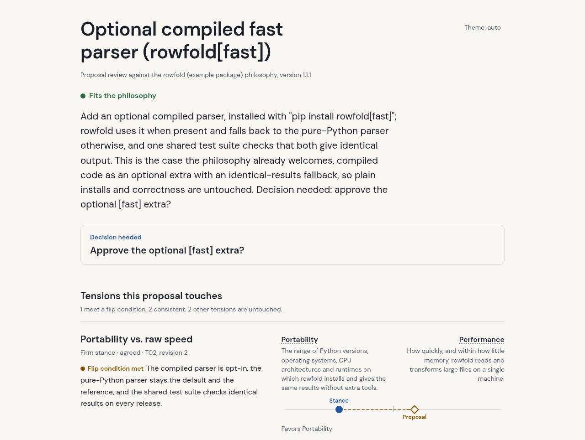
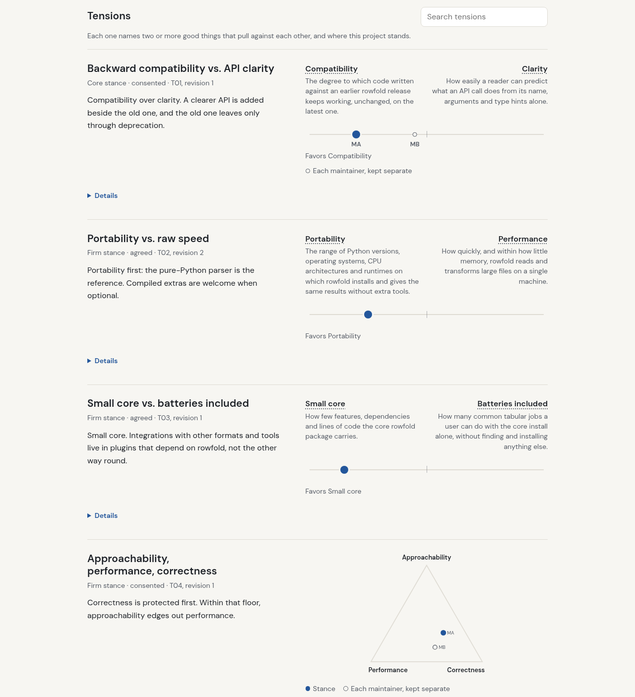

# architectural-philosophy

An agent skill that writes down how your project makes trade-offs, so that every agent working on it, yours
and your contributors', can follow the same intent.

Development now moves at the speed of agents: maintainers' own pipelines and contributors'. Writing code is no
longer the hard part. Keeping a project's intent consistent is. This skill interviews maintainers and records
the project's trade-offs: defined values, the tensions between good things, where the project stands on each,
the conditions under which a stance flips, hard limits, and precedents. Agents then read that record before
they write code and attach a short, advisory decision card to each proposal. The philosophy evolves through
logged amendments, and when maintainers disagree, the disagreement stays visible instead of being averaged
away.



## What it is

A skill folder in the open Agent Skills format (a `SKILL.md` with `references/`, `assets/` and `scripts/`). It
covers the whole lifecycle:

**Establish.** The agent acts as a neutral facilitator. It interviews each maintainer in four styles: abstract
discussion of values, a walkthrough of a real past decision, forced-choice scenarios, and checks for
contradictions between answers. No value is weighed until the maintainer has explained it in their own words
and confirmed a written definition. For questions that are easier to answer visually, such as placing a stance
between three values, it can open a small browser canvas.

**Apply.** Any agent proposing or reviewing a change reads the philosophy, checks the hard limits, and writes
a decision card that opens with a two-to-four sentence bottom line and cites the touched trade-offs by ID. It
is advisory by default; a project can raise it to flag-and-ask or a review gate.

**Evolve.** Stances change through logged amendments, interviews resume across sessions, and several
maintainers' philosophies are reconciled into a shared one in rounds that keep dissent on the record.

## What you get in your repository

By default the skill writes to `docs/philosophy/`, after asking. It assumes no existing documentation system
and does not touch your `AGENTS.md`, `CLAUDE.md` or similar files without your permission.

```
docs/philosophy/
├── philosophy.json          canonical data: glossary, hard limits, tensions, stances (edit this)
├── PHILOSOPHY.md            generated readable view; what agents read by default
├── philosophy-map.html      generated interactive map; one self-contained file, opens from disk
├── AMENDMENTS.md            append-only amendment log
├── GOVERNANCE.md            teams only: participants, decision rules, comment windows, strictness
├── individuals/<handle>/    teams: each maintainer's own philosophy, session notes and canvases
├── reconciliation/          teams only: one folder per reconciliation cycle
└── proposals/               optional: proposal files shown on the map
```

A solo maintainer's answers go straight into `philosophy.json`. In a team, each person's answers go into their
own file, and the shared file comes from reconciliation.



## Install

No single folder is read by every agent host, so the recommended layout uses two: the real folder at
`.agents/skills/architectural-philosophy/`, and a symlink at `.claude/skills/architectural-philosophy` that
points to it. From your project's root:

```bash
git clone --depth 1 https://github.com/brhkim/architectural_philosophy.git .ap-tmp
mkdir -p .agents/skills .claude/skills
cp -R .ap-tmp/skills/architectural-philosophy .agents/skills/
ln -s ../../.agents/skills/architectural-philosophy .claude/skills/architectural-philosophy
rm -rf .ap-tmp
```

On a checkout without symlink support (some Windows setups), copy the folder into `.claude/skills/` as well.
Or copy it only into the one folder your host reads:

| Host | Where the skill goes |
|------|---------------------|
| Claude Code | `.claude/skills/` in the project, or `~/.claude/skills/` for all projects. On the web, commit it to the repository |
| OpenAI Codex (CLI, IDE, desktop app) | `.agents/skills/` in the project, or `~/.agents/skills/`. Loading in Codex cloud is unverified |
| GitHub Copilot (VS Code, CLI) | Any of `.github/skills/`, `.claude/skills/`, `.agents/skills/`. For the cloud agent, commit it to the repository |
| Cursor | `.agents/skills/` or `.cursor/skills/` (it also reads `.claude/skills/`) |
| Gemini CLI | `.agents/skills/` or `.gemini/skills/`, then approve the activation prompt |
| claude.ai and Claude desktop chat | Turn on code execution, zip the folder, and upload it as a skill |
| ChatGPT | Standalone skills are desktop-only; on the web, a skill must come inside a plugin |

Host features change often; this table reflects a documentation review dated 2026-11-20. For hosts or
sessions that do not load skills, the skill can add a two-line pointer to your `AGENTS.md` (or equivalent),
with your permission.

## Quick start

Ask your agent, in plain words:

- "Use the architectural-philosophy skill to interview me about this project's trade-offs."
- "Check this change against our philosophy and write a decision card."
- "Amend our stance on T02."

A first interview runs 30 to 60 minutes and covers three to five tensions. It saves after every tension, so
you can stop and pick up later.

## Example: rowfold

[`examples/rowfold/`](examples/rowfold/) is a complete example for a fictional package, rowfold: a small,
pure-Python library for reading tabular files that many projects depend on. It contains the
[philosophy data](examples/rowfold/philosophy.json), its [readable view](examples/rowfold/PHILOSOPHY.md), the
[map page](examples/rowfold/philosophy-map.html), an [interview canvas](examples/rowfold/canvas-demo.html), and
two reviews of competing proposals for a faster parser:

- [Rewrite the core parser as a required C extension](examples/rowfold/proposals/required-c-extension.html)
  puts a hard limit at risk ("installing rowfold never needs a compiler") and asks for a decision.
- [Add an optional compiled parser](examples/rowfold/proposals/optional-fast-parser.html) fits the
  philosophy. Its bottom line:

> Add an optional compiled parser, installed with "pip install rowfold[fast]"; rowfold uses it when present
> and falls back to the pure-Python parser otherwise, and one shared test suite checks that both give
> identical output. This is the case the philosophy already welcomes, compiled code as an optional extra with
> an identical-results fallback, so plain installs and correctness are untouched. Decision needed: approve the
> optional [fast] extra?

GitHub shows HTML files as source; clone or download the repository and open them from disk in a browser.

## Requirements

Plain files. Python 3's standard library is optional, for the two helper scripts: one renders `PHILOSOPHY.md`
and the map page from the JSON, and one serves a canvas and collects the answers. Both have a no-Python
fallback. No packages, no network, no build step.

## Status

Prototype, v0.1, built for a hackathon on 2026-11-20. The data format is a draft and may change. Feedback is
welcome through [issues](https://github.com/brhkim/architectural_philosophy/issues).

## License

[MIT](LICENSE).
