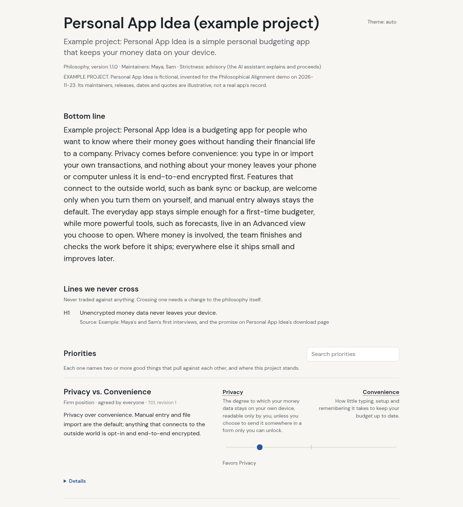

# Philosophical Alignment

**Your vision and judgment, carried through every step.**

Help your AI assistants work in line with your vision, core principles, priorities, expertise, taste, and judgment—at every step of a project.

Whether you are building software, running research, making a game, working with data, or writing—alone, on a team, or in open source—a big project is full of hard decisions between good things. AI assistants move fast, so suggestions and edits pile up quickly, and you end up repeating the same directions and judgment on every change.

Philosophical Alignment captures your values and priorities once, in plain files inside your project, and carries them through planning, building, review, and revision. The files it creates keep the name **philosophy** (`docs/philosophy/`, `PHILOSOPHY.md`, `philosophy.json`): the philosophy is what you write down; alignment is what you get. The aim: work from your AI assistants that lands closer to your vision from the start, and takes less of your time to review.

<!-- Pitch video (2:36): add the GitHub upload link on the line below, in the web editor. -->


## Where it fits in your work

Once your principles are written down, your AI assistants carry them through four phases:

- **Planning.** Before choosing an approach, the AI assistant checks the plan against your priorities and picks the route that fits—or stops to ask if the work would cross a line you never cross.
- **Building.** It builds the chosen route. On stricter settings, it stops before building anything that departs from where you stand.
- **Review.** Each significant change arrives with a **decision card**: a short summary of which priorities it touched and how it handled each, so you can judge the work on vision and taste as well as the technical pieces.
- **Revision.** Feedback can name the exact priority, so fixes stay targeted. When a principle itself no longer fits, the AI assistant proposes an update rather than quietly bending it.

## How it works

Philosophical Alignment is a **skill**—a small folder of plain instructions in the open Agent Skills format (`SKILL.md`, plus `references/`, `assets/`, and `scripts/`) that AI assistants can load. It covers the full lifecycle of your project's principles:

**Capture your philosophy.** The AI assistant acts as a neutral facilitator and interviews you—or each person on your team—in four ways: open discussion of your values, a walkthrough of a real past decision, forced-choice scenarios, and checks for contradictions between your answers. No value is weighed until you explain it in your own words and confirm a written definition. For questions that are easier to answer visually, such as placing where you stand between three values, it can open a small canvas in your browser.

**Apply it to every change.** Any AI assistant proposing or reviewing work reads the written philosophy, checks the lines you never cross, and attaches a decision card that opens with a two-to-four sentence bottom line and names each priority it touched. By default the AI assistant explains and proceeds; you can set it to stop and ask first, or to wait for your written approval.

**Evolve it over time.** When your reviews and decisions reveal new or shifting priorities, the AI assistant proposes an update, and each approved update is logged with its reason. Interviews save as you go and resume across sessions, and teammates' individual philosophies are combined into a shared one in rounds that keep disagreements visible instead of averaging them away.

## What you get in your project

By default, the skill writes to `docs/philosophy/` after asking your permission. It assumes no existing documentation setup and does not touch `AGENTS.md`, `CLAUDE.md`, or similar files without your permission.

```text
docs/philosophy/
├── philosophy.json          canonical data (edit this): glossary, hard_limits (lines you never cross),
│                            tensions (competing priorities), stances (where you stand), and
│                            flip_conditions (exceptions you'd accept)
├── PHILOSOPHY.md            generated readable summary; what AI assistants read by default
├── philosophy-map.html      generated interactive page; one self-contained file you open in a browser
├── AMENDMENTS.md            append-only log of updates to your philosophy
├── GOVERNANCE.md            teams only: participants, decision rules, comment windows, strictness
├── individuals/<handle>/    teams: each person's own philosophy, session notes, and canvases
├── reconciliation/          teams only: one folder per reconciliation cycle
└── proposals/               optional: proposal reviews shown on the interactive page
```

If you work alone, your answers go straight into `philosophy.json`. On a team, each person's answers go into their own file first, and the shared file comes from reconciliation.



## Examples

Two examples live in `examples/` so you can see what the files and decision cards look like before trying it yourself.

### Personal App Idea

[`examples/personal-app-idea/`](examples/personal-app-idea/) is a fictional, simple personal budgeting app that keeps your money data on your device. One line it never crosses is that *unencrypted money data never leaves your device*. It contains the [philosophy data](examples/personal-app-idea/philosophy.json), its [readable summary](examples/personal-app-idea/PHILOSOPHY.md), the [interactive page](examples/personal-app-idea/philosophy-map.html), and an [interview canvas](examples/personal-app-idea/canvas-demo.html).

Its showcase walks through a request for "automatic bank sync." Rather than sending financial data off the device in the clear, the [proposed approach](examples/personal-app-idea/proposals/encrypted-sync.html) offers opt-in, end-to-end encrypted sync while keeping manual entry as the default—accompanied by a decision card showing how it honored the project's values and priorities. Two more reviews show what happens otherwise: [sync through the app's own server](examples/personal-app-idea/proposals/server-sync.html) puts the line it never crosses at risk and asks for a decision, and [forecast charts on the home screen](examples/personal-app-idea/proposals/forecast-charts.html) depart from where the project stands on simplicity.

### rowfold

[`examples/rowfold/`](examples/rowfold/) is a fictional, small pure-Python library for reading tabular files that many projects depend on. It contains the [philosophy data](examples/rowfold/philosophy.json), its [readable summary](examples/rowfold/PHILOSOPHY.md), the [interactive page](examples/rowfold/philosophy-map.html), an [interview canvas](examples/rowfold/canvas-demo.html), and reviews of two competing proposals for a faster parser:

- [Rewrite the core parser as a required C extension](examples/rowfold/proposals/required-c-extension.html) puts a line the project never crosses at risk ("installing rowfold never needs a compiler") and asks for a decision.
- [Add an optional compiled parser](examples/rowfold/proposals/optional-fast-parser.html) fits the project's priorities. Its bottom line:

> Add an optional compiled parser, installed with "pip install rowfold[fast]"; rowfold uses it when present and falls back to the pure-Python parser otherwise, and one shared test suite checks that both give identical output. This is the case the philosophy already welcomes, compiled code as an optional extra with an identical-results fallback, so plain installs and correctness are untouched. Decision needed: approve the optional [fast] extra?

GitHub shows HTML files as source code; clone or download the repository and open them from disk in your browser.

## Install

No single folder is read by every AI assistant host, so the recommended setup uses two locations: the real folder at `.agents/skills/philosophical-alignment/`, and a symlink at `.claude/skills/philosophical-alignment` that points to it. From your project's root folder:

```bash
git clone --depth 1 https://github.com/brhkim/philosophical-alignment .pa-tmp
mkdir -p .agents/skills .claude/skills
cp -R .pa-tmp/skills/philosophical-alignment .agents/skills/
ln -s ../../.agents/skills/philosophical-alignment .claude/skills/philosophical-alignment
rm -rf .pa-tmp
```

On a checkout without symlink support (some Windows setups), copy the folder into `.claude/skills/` as well. Or copy it only into the single folder your host reads:

| Host | Where the skill goes |
|------|---------------------|
| Claude Code | `.claude/skills/` in the project, or `~/.claude/skills/` for all projects. On the web, commit it to the repository |
| OpenAI Codex (CLI, IDE, desktop app) | `.agents/skills/` in the project, or `~/.agents/skills/`. Loading in Codex cloud is unverified |
| GitHub Copilot (VS Code, CLI) | Any of `.github/skills/`, `.claude/skills/`, `.agents/skills/`. For the cloud agent, commit it to the repository |
| Cursor | `.agents/skills/` or `.cursor/skills/` (it also reads `.claude/skills/`) |
| Gemini CLI | `.agents/skills/` or `.gemini/skills/`, then approve the activation prompt |
| claude.ai and Claude desktop chat | Turn on code execution, zip the folder, and upload it as a skill |
| ChatGPT | Standalone skills are desktop-only; on the web, a skill must come inside a plugin |

Host features change often; this table reflects a documentation review dated 2026-11-20. For hosts or sessions that do not load skills, the skill can add a two-line pointer to your `AGENTS.md` (or equivalent), with your permission.

## Quick start

Ask your AI assistant, in plain words:

- "Use the philosophical-alignment skill to interview me about this project's values and priorities."
- "Check this change against our philosophy and write a decision card."
- "Update where we stand on privacy versus convenience."

A first interview runs 30 to 60 minutes and covers three to five competing priorities. It saves after each one, so you can stop and pick up later.

## Requirements

Plain files. Python 3's standard library is optional, for the two helper scripts: one renders `PHILOSOPHY.md` and `philosophy-map.html` from the JSON file, and one serves a browser canvas and collects the answers. Both have a no-Python fallback. No packages, no network, no build step.

## Status

Prototype, v0.2 (renamed from Architectural Philosophy on 2026-11-24; first built for a hackathon on 2026-11-20). The data format is a draft and may change. Whether this approach measurably improves AI assistants' work has not been tested yet. Feedback is welcome through [issues](https://github.com/brhkim/philosophical-alignment/issues).

## License

[MIT](LICENSE).
